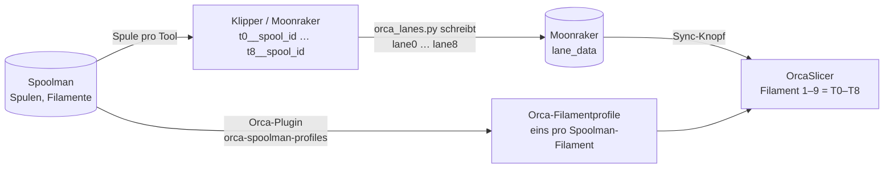
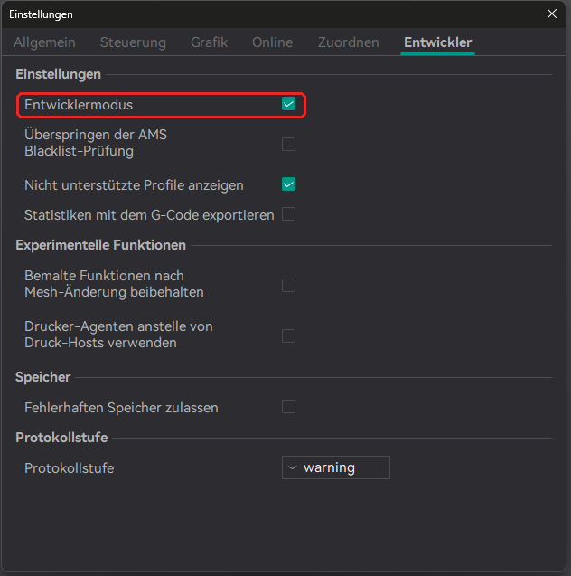

# OrcaSlicer

[English version → ORCASLICER.md](ORCASLICER.md) ·
[README](../README.de.md)

Druckerprofil für diese Maschine sowie Filamentprofile und Farben aus Spoolman
(OrcaSlicer 2.5.x unter Windows).

**Voraussetzung:** Für das Druckerprofil nur OrcaSlicer. Für die Abschnitte
2–5 außerdem Spoolman, eingerichtet wie in [SPOOLMAN.de.md](SPOOLMAN.de.md),
und den Tools zugeordnete Spulen.

## 1. Druckerprofil

`orca/Voron Trident 350 INDX.json` hat Maschinenlimits passend zur
Klipper-Config (300 mm/s, 3000 mm/s², Square Corner Velocity 5), damit die
Zeitschätzung stimmt. In Orca importieren (Menü *File → Import →
Import Configs*, in der deutschen Oberfläche entsprechend) und anpassen:

- Düsen: T0–T4 0.4, T5–T6 0.6, T7–T8 0.25 – die eigenen eintragen.
- Toolwechselzeit und Startzeit sind Schätzwerte; an der eigenen Maschine
  stoppen.
- Der G-Code *Vor dem Schichtwechsel* enthält `TIMELAPSE_TAKE_FRAME` für
  moonraker-timelapse. Ohne Timelapse die Zeile löschen, sonst meldet Klipper
  bei jeder Schicht einen unbekannten Befehl.

Zwei Einstellungen, die Ärger mit Klipper vermeiden:
- **Ruck:** Bei Klipper behandelt Orca `machine_max_jerk_x/y` als
  `square_corner_velocity` und warnt. Im Prozessprofil *Standard-Ruck* auf 0
  setzen; dann sendet Orca keine Ruck-Befehle und es gilt der Wert aus
  Klipper.
- **Pressure Advance:** normaler PA-Wert pro Filament, kein *adaptives PA*
  (schickt sehr viele `SET_PRESSURE_ADVANCE` an Klipper).

**Kontrolle:** Ein kleines Objekt mit zwei Tools slicen: Die G-Code-Vorschau
zeigt `T0`/`T1`, die geschätzte Zeit ist plausibel.

## So funktioniert der Filamentabgleich



Der Drucker schreibt pro Tool Material, Farbe und Filament-ID der Spule in
Moonrakers `lane_data`. Eine *Lane* ist ein Eintrag pro Tool: `lane0` = T0 …
`lane8` = T8, z. B. `lane3` = „PETG, rot, Filament-ID PSM12“. OrcaSlicer liest
die Lanes beim Filamentabgleich und wählt pro Filament 1–9 das passende
Profil. Die Profile erzeugt ein Orca-Plugin aus den Filamenten in Spoolman.

## 2. Einmalig in OrcaSlicer

1. Einstellungen → Reiter *Entwickler*: **Entwicklermodus** anhaken
   (englisch: *Developer mode*). Die übrigen Optionen dort bleiben, wie sie
   sind.

   

2. Eigenes Druckerprofil bearbeiten (*Drucker-Einstellungen → Grundlegende
   Informationen*), Ansicht *Erweitert*: **Drucker-Agent = Moonraker**. Als
   Adresse `<DRUCKER-IP>` ohne Port eintragen. **Kontrolle:** Der Reiter
   „Gerät (Web)“ zeigt Mainsail mit dem aktuellen Druckerstatus.

   
3. Orca legt den Drucker mit `"printer_agent_id": "orca"` an; es muss
   `"moonraker"` sein. Das ist die einzige Handarbeit in einer Datei:
   1. **OrcaSlicer schließen** (Orca schreibt die Datei beim Beenden neu).
   2. **Sicherung** von `%APPDATA%\OrcaSlicer\OrcaSlicer.conf` anlegen (Datei kopieren).
   3. In einem Texteditor öffnen und nach `printer_agent_id` suchen (Strg+F).
      Unter `local_machines` den Eintrag des eigenen Druckers nehmen (er
      enthält dessen Namen bzw. IP) und genau diese eine Zeile ändern:
      ```
      vorher:   "printer_agent_id": "orca",
      nachher:  "printer_agent_id": "moonraker",
      ```
      Sonst nichts ändern.
   4. Speichern, Orca starten. Startet Orca nicht oder fehlen Einstellungen,
      die Sicherung zurückkopieren.

Der Knopf zum Abgleichen erscheint erst, wenn in `lane_data` mindestens eine
Lane steht (Abschnitt 3).

## 3. Drucker: Lanes werden automatisch geschrieben

Nichts zusätzlich zu installieren: `macros/spoolman.cfg` (siehe
[SPOOLMAN.de.md](SPOOLMAN.de.md), Schritt 3) enthält diesen Teil schon,
zusammen mit den Skripten aus dem Repo:

| Datei | Was |
|---|---|
| `scripts/orca_lanes/orca_lanes.py` | Holt die Spulen über Moonrakers Spoolman-Proxy, schreibt `lane0`–`lane8` |
| `scripts/orca_lanes/orca_lanes_launch.sh` | Startet das Skript im Hintergrund (blockiert keinen Druck) |
| `macros/spoolman.cfg` | `[gcode_shell_command orca_lanes]`, `_ORCA_LANES`, `ORCA_LANES_SYNC`; `_SPOOL_WATCH` ruft `_ORCA_LANES` auf |

Benötigt `gcode_shell_command` (in Kalico enthalten) und den richtigen
Benutzernamen im Pfad (siehe [INSTALLATION.de.md](INSTALLATION.de.md),
Schritt 7).

Das Skript läuft wieder, sobald sich eine Zuweisung ändert (`SET_TOOL_SPOOL`,
Mainsail-Dialog). Nach Änderungen an einer Spule in Spoolman selbst (z. B.
Farbe korrigiert): `ORCA_LANES_SYNC`. Log: `~/printer_data/logs/orca_lanes.log`.

**Kontrolle:** Etwa 10 s nach dem Start kommt in der Konsole z. B.
„Orca-Lanes: 9 tools sent, 3 with spool“. Per SSH:

```bash
curl -s "http://localhost:7125/server/database/item?namespace=lane_data"
```

Eine Lane sieht so aus: `{"lane": "0", "material": "PLA", "spool_id": 11, "filament_id": "PSM11", "color": "#F9FDFF"}`.
Tools ohne Spule haben `"material": ""` und sind in Orca leer.

## 4. PC: Profile aus Spoolman erzeugen (Orca-Plugin)

Die Profile erzeugt das OrcaSlicer-Plugin **Spoolman Profiles** (ab OrcaSlicer
2.5.0). Es hat ein eigenes Repo:
[daum1988/orca-spoolman-profiles](https://github.com/daum1988/orca-spoolman-profiles). Dort stehen Installation, alle
Einstellungen, die Zusatzfelder, die Statistik und die Fehlersuche ausführlich.

Kurz für diese Maschine:

1. **Installieren:** in der Orca Cloud *Spoolman Profiles* abonnieren, oder
   `spoolman_profiles.py` aus dem Plugin-Repo nach
   `%APPDATA%\OrcaSlicer\orca_plugins\spoolman_profiles\` legen. Dann
   *Datei → Plugins* → *Aktivieren*, Rückfragen nach Netzwerk und Threads
   erlauben.
2. **Vorlagen:** pro Material ein *eigenständiges* Filament `SM-Vorlage
   <Material>` (z. B. `SM-Vorlage PLA`), kompatibel mit dem Drucker. Im
   Filament-Startcode **kein** `SET_ACTIVE_SPOOL`.
3. **Einstellungen:** *Datei → Plugins* → „Spoolman Profiles“ → *Config* →
   **Update profiles from Spoolman**: Spoolman-Adresse
   (`http://<SPOOLMAN-IP>:7912`), Druckeradresse (`http://<DRUCKER-IP>`) und
   *Tool statistics since* = Datum des INDX-Umbaus. *Save*, Orca neu starten.
4. **Profile erzeugen:** Reiter **Spools & Stats** → **Update profiles from
   Spoolman** (läuft auch bei jedem Start von Orca). Die Profile heißen
   `<Hersteller> <Name> (SM<id>) @Voron Trident 350 <Düse> nozzle`, haben die
   Filament-ID `PSM<id>` und stehen in der Filamentliste unter
   **Bundle presets → Spoolman Profiles**.
5. **Abgleich:** Drucker wählen, im Bereich *Filament* den Sync-Knopf (rechts
   neben der Überschrift) drücken. Orca zählt ab 1: Filament 1 = T0 …
   Filament 9 = T8.

   

**Kontrolle:** Filament 1–9 bekommen Profil und Farbe der Spulen auf T0–T8.

Die Statistik im selben Reiter liest Moonrakers Druckhistorie: Verbrauch gesamt
und seit dem INDX-Umbau, Toolwechsel inklusive INDX-Zähler `toolchange_count`,
Gramm pro Tool T0–T8, fast leere Spulen und die Druckhistorie mit
Timelapse-Videos.

**Umstieg vom PowerShell-Skript:** Die alten Profile (`… (SM<id>) …` in
`user\<Konto>\filament\base\`, Filament-ID `PSM…`) haben dieselbe ID wie die
des Plugins; dann ist der Abgleich nicht mehr eindeutig. Das Plugin warnt
davor in der Statuszeile. Orca schließen, den Ordner sichern, die alten
`PSM`-Profile (`.json` und `.info`, nicht die `SM-Vorlage`-Dateien) löschen,
Orca starten. Waren sie mit der Orca-Cloud synchronisiert, bleibt dort eine
Kopie; taucht sie wieder auf, erneut löschen.

`orca/orca_spoolman_profiles.ps1` bleibt im Repo als Alternative ohne Plugin
(Orca schließen, `powershell -ExecutionPolicy Bypass -File
.\orca_spoolman_profiles.ps1 -SpoolmanUrl http://<SPOOLMAN-IP>:7912`,
`-WhatIf` für einen Probelauf). Nicht beides gleichzeitig verwenden.

**Hinweise**
- Orca vergleicht die Filament-ID nur mit eigenständigen Profilen (ohne „erbt
  von“). Deshalb nicht spoolman2slicer nehmen: dessen Profile erben von
  „Voron Generic …“. Aus demselben Grund findet der Abgleich die Presets von
  Spoolio nicht. Spoolio kann parallel laufen, um Spulen anzulegen; dort
  *Configure OrcaSlicer Presets* aus und den Verbrauch auf *Do Not Track*
  (den bucht Moonraker).
- Den Reiter „Gerät“ (Bambu-Ansicht) ignorieren; Steuerung weiter über Mainsail.
- Der Verbrauch wird unabhängig vom Slicer gebucht; Orca muss nur `T0`…`T8` ausgeben.

## 5. Einstellungen pro Filament zentral in Spoolman

Grundeinstellungen stehen in der Orca-Vorlage (eine pro Düsengröße).
Abweichungen pro Filament trägst du in Spoolman beim Filament in die
Zusatzfelder ein; das Plugin übernimmt sie beim nächsten Abgleich in die
Profile. Die SM-Profile selbst nicht in Orca bearbeiten, sie werden bei jedem
Abgleich neu erzeugt.

| Zusatzfeld | Orca-Einstellung |
|---|---|
| `filament_flow_ratio` | Flussrate |
| `filament_max_volumetric_speed` (+ `_d025`, `_d04`, `_d06`) | Max. Volumenstrom |
| `filament_retraction_length`, `filament_retraction_speed` | Retract |
| `fan_min_speed`, `fan_max_speed` | Lüfter |
| `filament_shrink`, `filament_shrinkage_compensation_z` | Schrumpfung (XY), Schrumpfung (Z), in % (z. B. `99.5`; 100 = keine Korrektur) |

- Leer = Wert der Vorlage.
- Endung `_d025`/`_d04`/`_d06`: gilt nur für diese Düse und hat dort Vorrang
  vor dem Feld ohne Endung.
- Weitere Einstellungen: in Spoolman (Einstellungen → Zusatzfelder →
  Filament) ein Feld anlegen, dessen Schlüssel genau der Orca-Einstellung
  entspricht. Unbekannte Schlüssel meldet das Plugin als Warnung.
- Spoolios Feldnamen `flow_ratio`, `max_volumetric_speed`,
  `retraction_length`, `retraction_speed` liest das Plugin als Ersatz, wenn
  das Orca-Feld fehlt (Einstellung, Standard: an).
- `pressure_advance*` schreibt die Load-Cell-Kalibrierung (`PA_CAL_LOADCELL`,
  siehe [CALIBRATION.de.md](CALIBRATION.de.md), Schritt 8) in Spoolman. Das
  Plugin übernimmt den Wert nach Orca (`pressure_advance`, Düsenfeld hat
  Vorrang) und schaltet `enable_pressure_advance` ein. Orca setzt PA dann beim
  Filamentwechsel im G-Code.

Danach im Reiter **Spools & Stats** **Update profiles from Spoolman** drücken (oder Orca neu starten).

Probleme: siehe [TROUBLESHOOTING.de.md](TROUBLESHOOTING.de.md#spoolman-und-orcaslicer).
