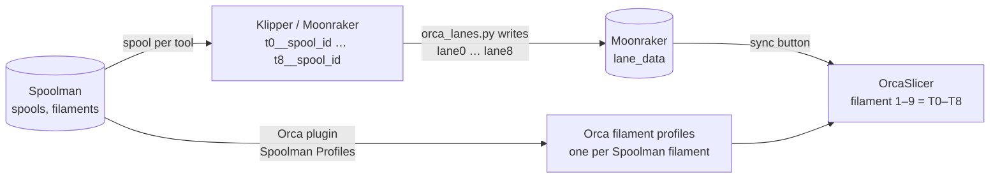
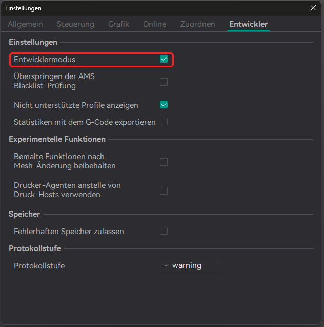
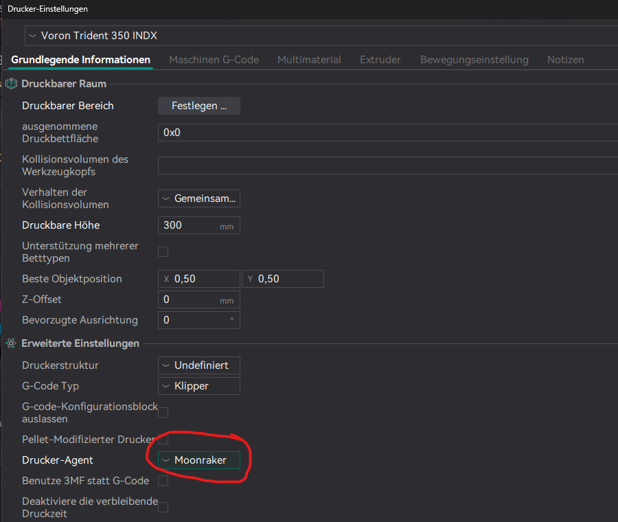
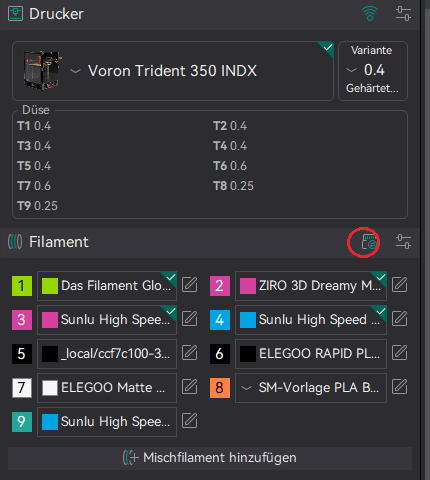

# OrcaSlicer

[Deutsche Version → ORCASLICER.de.md](ORCASLICER.de.md) ·
[README](../README.md)

Printer profile for this machine, and filament profiles and colours from
Spoolman (OrcaSlicer 2.5.x on Windows).

**Requires:** for the printer profile only OrcaSlicer. For sections 2–5 also
Spoolman set up as in [SPOOLMAN.md](SPOOLMAN.md) and spools assigned to the
tools.

## 1. Printer profile

`orca/Voron Trident 350 INDX.json` has machine limits matching the Klipper
config (300 mm/s, 3000 mm/s², square corner velocity 5), so slicer time
estimates are realistic. Import it in Orca (*File → Import → Import
Configs*) and adjust:

- Nozzles: T0–T4 0.4, T5–T6 0.6, T7–T8 0.25 – set yours.
- Tool change time and start time are rough guesses; time your own machine.
- *Before layer change G-code* contains `TIMELAPSE_TAKE_FRAME` for
  moonraker-timelapse. Without timelapse remove that line, otherwise Klipper
  reports an unknown command on every layer.

Two settings that avoid trouble with Klipper:
- **Jerk:** with Klipper flavour, Orca treats `machine_max_jerk_x/y` as
  `square_corner_velocity` and warns. Set *Default jerk* in the process
  profile to 0; Orca then sends no jerk commands and Klipper's value applies.
- **Pressure advance:** plain PA per filament, no *adaptive PA* (floods
  Klipper with `SET_PRESSURE_ADVANCE`).

**Check:** slicing a small object with two tools shows `T0`/`T1` in the
G-code preview, and the estimated time is plausible.

## How the filament sync works



Per tool, the printer writes the spool's material, colour and filament ID
into Moonraker's `lane_data`. A *lane* is one entry per tool: `lane0` = T0 …
`lane8` = T8, e.g. `lane3` = "PETG, red, filament ID PSM12". OrcaSlicer reads
the lanes when syncing filaments and picks the matching profile for filament
1–9. The profiles are generated from the filaments in Spoolman by an Orca
plugin.

## 2. Once in OrcaSlicer

1. Preferences → tab *Developer*: tick **Developer mode** (screenshot: German
   UI). Leave the other options there as they are.

   

2. Edit your printer profile (*Printer settings → Basic information*),
   *Advanced* view: **Printer agent = Moonraker**. Enter `<PRINTER-IP>` as
   address, without port. **Check:** the "Device (Web)" tab shows Mainsail
   with the current printer status.

   
3. Orca creates the printer entry with `"printer_agent_id": "orca"`; it must
   be `"moonraker"`. This is the only manual file edit:
   1. **Close OrcaSlicer** (it rewrites the file on exit).
   2. **Back up** `%APPDATA%\OrcaSlicer\OrcaSlicer.conf` (copy it).
   3. Open it in a text editor and search for `printer_agent_id` (Ctrl+F).
      Take the entry of your printer under `local_machines` (it contains its
      name or IP) and change exactly this one line:
      ```
      before:  "printer_agent_id": "orca",
      after:   "printer_agent_id": "moonraker",
      ```
      Leave everything else as it is.
   4. Save and start Orca. If Orca does not start or loses settings, put the
      backup back.

The sync button only appears once `lane_data` contains at least one lane
(section 3).

## 3. Printer: lanes are written automatically

Nothing extra to install: `macros/spoolman.cfg` (see [SPOOLMAN.md](SPOOLMAN.md),
step 3) already contains this part, together with the scripts from this repo:

| File | Purpose |
|---|---|
| `scripts/orca_lanes/orca_lanes.py` | Fetches the spools via Moonraker's Spoolman proxy, writes `lane0`–`lane8` |
| `scripts/orca_lanes/orca_lanes_launch.sh` | Starts the script in the background (never blocks a print) |
| `macros/spoolman.cfg` | `[gcode_shell_command orca_lanes]`, `_ORCA_LANES`, `ORCA_LANES_SYNC`; `_SPOOL_WATCH` calls `_ORCA_LANES` |

Requires `gcode_shell_command` (built into Kalico) and the correct user name
in the path (see [INSTALLATION.md](INSTALLATION.md), step 7).

The script runs again whenever an assignment changes (`SET_TOOL_SPOOL`,
Mainsail dialog). After changing a spool in Spoolman itself (e.g. corrected
colour): `ORCA_LANES_SYNC`. Log: `~/printer_data/logs/orca_lanes.log`.

**Check:** about 10 s after startup the console shows e.g.
"Orca-Lanes: 9 tools sent, 3 with spool". Via SSH:

```bash
curl -s "http://localhost:7125/server/database/item?namespace=lane_data"
```

A lane looks like `{"lane": "0", "material": "PLA", "spool_id": 11, "filament_id": "PSM11", "color": "#F9FDFF"}`.
Tools without a spool have `"material": ""` and are empty in Orca.

## 4. PC: generate profiles from Spoolman (Orca plugin)

The plugin `orca/spoolman_profiles/spoolman_profiles.py` creates the
profiles directly inside OrcaSlicer (2.5.0 or newer) and reloads them without
a restart. It also shows the Spoolman web UI in the **Spoolman** tab; button,
status and settings are in the **Spoolman Profiles** tab.

1. **Create templates (once):** in Orca, create a *standalone* filament per
   material (Filament → *Create filament*, not "copy" of a system profile),
   compatible with your printer, with your proven settings. Name:
   `SM-Vorlage PLA`, `SM-Vorlage PETG`, … (Orca creates one variant
   "… @<printer> 0.4 nozzle" per nozzle size; every variant is used). **No**
   `SET_ACTIVE_SPOOL` in the filament start G-code.
2. **Install:** close Orca. Create the folder
   `%APPDATA%\OrcaSlicer\orca_plugins\spoolman_profiles\` and copy
   `spoolman_profiles.py` into it. Start Orca, *File → Plugins*, tick
   **Activate** for "Spoolman Profiles". Allow the prompts for network access
   (Spoolman) and threads.
3. **Set up:** *File → Plugins* → "Spoolman Profiles" → *Config* → entry
   **Update profiles from Spoolman** (at the top; the tab entries have no
   settings of their own), or the **Spoolman Profiles** tab: enter the
   Spoolman address
   (`http://<SPOOLMAN-IP>:7912` or your own domain), *Save*. The template
   prefix (e.g. `SM-Template`), update on start, Spoolio fields and archived
   filaments are set there too, as is the **layout**: two tabs (default),
   only the Spoolman tab (button through the command as a window) or only the
   Spoolman Profiles tab (Spoolman in the browser). The layout applies after
   restarting Orca. The settings stay local in
   `%APPDATA%\OrcaSlicer\spoolman_profiles\settings.json`. Then restart Orca:
   the **Spoolman** tab loads the address at start.
4. **Generate profiles:** tab **Spoolman Profiles** → press **Update
   profiles from Spoolman**. The same is available as a window through the
   command *Update profiles from Spoolman* (*File → Plugins* or the command
   palette). The status line shows e.g. "114 new … Loaded in OrcaSlicer: 114
   profiles, 38 of them compatible with the selected printer". With *Update
   automatically when OrcaSlicer starts* (default: on) this runs on every start; a notification
   only appears for changes or errors. The profiles are named
   `<Vendor> <Name> (SM<id>) @<printer> <nozzle> nozzle` and have filament ID
   `PSM<id>`. In the filament list they are under **Bundle presets →
   Spoolman Profiles**.
5. **Sync:** select the printer, press the sync button in the *Filament*
   area (right of the heading). Orca counts from 1: filament 1 = T0 …
   filament 9 = T8.

   

**Check:** filament 1–9 get the profile and colour of the spools on T0–T8.

Taken from Spoolman: name, vendor, colour, density, diameter, nozzle and bed
temperature (the first-layer offset stays as in the template), price per kg.
Anything empty in Spoolman stays as in the template. Material matching: exact
template, otherwise the longest matching one (`PLA+` → `SM-Vorlage PLA`).
Filaments with at least one non-archived spool get profiles (setting: all
others too). Profiles of filaments without an active spool are removed again.

How it works: the plugin writes the profiles as a local preset bundle to
`%APPDATA%\OrcaSlicer\user\<account or default>\_local\spoolman-profiles\`
and reloads it through Orca's plugin API. They are standalone profiles
without "inherits", so Orca's sync finds them by filament ID. Log:
`%APPDATA%\OrcaSlicer\spoolman_profiles\spoolman_profiles.log`.

The **Spoolman** tab loads the Spoolman page directly, not in a frame: inside a
frame, Orca's web view blocks Spoolman's browser storage and Spoolman then shows
"500 Internal Error".

**Switching from the PowerShell script:** the old profiles (`… (SM<id>) …`
in `user\<account>\filament\base\`, filament ID `PSM…`) carry the same IDs as
the plugin's, which makes the sync ambiguous. The plugin warns about this in
the status line. Close Orca, back up the folder, delete the old `PSM`
profiles (`.json` and `.info`, not the `SM-Vorlage` files), start Orca. If
they were synced to the Orca cloud, a copy stays there; if it comes back,
delete it again.

`orca/orca_spoolman_profiles.ps1` stays in the repo as an alternative without
the plugin (close Orca, `powershell -ExecutionPolicy Bypass -File
.\orca_spoolman_profiles.ps1 -SpoolmanUrl http://<SPOOLMAN-IP>:7912`, `-WhatIf`
for a dry run). Do not use both at the same time.

**Notes**
- Orca matches the filament ID only against standalone profiles (without
  "inherits"). That is why spoolman2slicer is not used here: its profiles
  inherit from "Voron Generic …". For the same reason the sync does not find
  Spoolio's presets. Spoolio can run alongside to create spools; there keep
  *Configure OrcaSlicer Presets* off and usage on *Do Not Track* (Moonraker
  books it).
- Ignore the "Device" tab (Bambu view); keep controlling the printer through Mainsail.
- Usage is tracked independently of the slicer; Orca only has to emit `T0`…`T8`.

## 5. Per-filament settings stored in Spoolman

Base settings live in the Orca template (one per nozzle size). Per-filament
deviations go into the filament's extra fields in Spoolman; the plugin
applies them to the profiles on the next update. Do not edit the SM profiles
in Orca, they are regenerated on every update.

| Extra field | Orca setting |
|---|---|
| `filament_flow_ratio` | Flow ratio |
| `filament_max_volumetric_speed` (+ `_d025`, `_d04`, `_d06`) | Max volumetric speed |
| `filament_retraction_length`, `filament_retraction_speed` | Retraction |
| `fan_min_speed`, `fan_max_speed` | Cooling fan |
| `filament_shrink`, `filament_shrinkage_compensation_z` | Shrinkage (XY), Shrinkage (Z), in % (e.g. `99.5`; 100 = no compensation) |

- Empty = template value.
- Suffix `_d025`/`_d04`/`_d06`: only applies to that nozzle size and takes
  precedence there over the field without suffix.
- More settings: create a field in Spoolman (Settings → Extra fields →
  Filament) whose key matches the Orca setting exactly. Unknown keys are
  reported by the plugin as a warning.
- Spoolio's field names `flow_ratio`, `max_volumetric_speed`,
  `retraction_length`, `retraction_speed` are read as a fallback when the Orca
  field is missing (setting, default: on).
- `pressure_advance*` is written to Spoolman by the load cell calibration
  (`PA_CAL_LOADCELL`, see [CALIBRATION.md](CALIBRATION.md), step 8). The
  plugin copies it to Orca (`pressure_advance`, the nozzle field takes
  precedence) and turns on `enable_pressure_advance`. Orca then sets PA on
  every filament change in the G-code.

Afterwards press **Update profiles from Spoolman** in the **Spoolman Profiles** tab (or restart Orca).

Problems: see [TROUBLESHOOTING.md](TROUBLESHOOTING.md#spoolman-and-orcaslicer).
