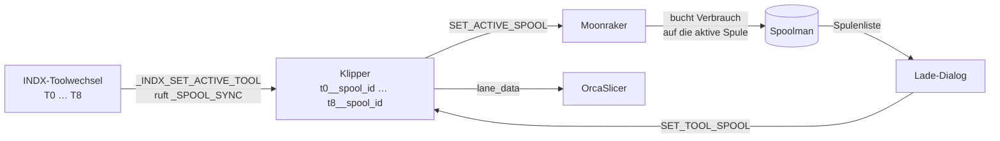

# Spoolman mit Bondtech INDX (T0–T8)

[English version → SPOOLMAN.md](SPOOLMAN.md)

Eine Spoolman-Spule pro INDX-Tool. Die aktive Spule wechselt mit dem Tool auf
dem Kopf, der Verbrauch landet also auf der richtigen Spule, und OrcaSlicer
kann Farbe und Profil jedes Tools übernehmen.

> Geschrieben für die Maschine aus diesem Repo (Voron Trident 350, INDX mit
> 9 Tools, Kalico, Mainsail, OrcaSlicer 2.5.x unter Windows). Namen wie das
> Orca-Druckerprofil „Voron Trident 350 INDX“, der Benutzer `pi` und die
> Anzahl der Tools stammen von dieser Maschine; an die eigene anpassen.

**Voraussetzungen:** die INDX-Config von Bondtech, `[save_variables]` mit
`indx_vars.cfg` (in diesem Repo in `config/INDX_toolhead.cfg`), der Inhalt von
`klipper/` aus diesem Repo im eigenen Config-Ordner (siehe
[INSTALLATION.de.md](INSTALLATION.de.md)), Moonraker mit Netzwerkzugriff auf
Spoolman.

## Wie es zusammenhängt



Vereinfacht: Jedes Tool hat eine in Klipper gespeicherte Spulen-ID. Wird ein
Tool aufgenommen, wird seine Spule in Moonraker die aktive Spule, und
Moonraker bucht das extrudierte Filament in Spoolman darauf. OrcaSlicer liest
die Zuordnung Tool → Spule (siehe [ORCASLICER.de.md](ORCASLICER.de.md)).

**Welche Schritte?**
- Spoolman läuft schon (auf dem Pi oder einem NAS) und Moonraker kennt es:
  Schritt 0 prüfen, dann Schritte 3 und 4.
- Spoolman läuft, aber `moonraker.conf` hat keinen Abschnitt `[spoolman]`:
  Schritte 0, 2, 3, 4.
- Noch kein Spoolman: Schritte 0–4.

## 0. Vorher prüfen: läuft Spoolman schon?

Steht in `moonraker.conf` schon ein Abschnitt `[spoolman]`, die Adresse aus
dessen Zeile `server:` im Browser öffnen.

- **Spoolman-Oberfläche erscheint:** Spoolman läuft schon (auf dem Pi oder auf
  einem anderen Gerät, z. B. einem NAS). Schritt 1 entfällt.
- **Keine Seite:** Spoolman installieren, z. B. auf dem Pi wie in Schritt 1.
  Ob die Adresse aus `server:` der Pi selbst ist, zeigt `hostname -I` auf
  dem Pi.

Ohne Abschnitt `[spoolman]`: Spoolman installieren (Schritt 1) und den
Abschnitt in Schritt 2 ergänzen.

## 1. Installation auf dem Pi (per SSH)

**Empfehlung: Standalone.** Ein CM4 hat wenig RAM, und Docker bringt einen
zusätzlichen Daemon und mehr Speicherbedarf mit. Standalone läuft als
systemd-Dienst und kann über den Update-Manager in Mainsail aktualisiert
werden. Docker lohnt sich nur, wenn auf dem Pi ohnehin schon Docker läuft.

```bash
cd ~ && sudo apt-get update && sudo apt-get install -y curl jq unzip
```

```bash
mkdir -p ~/Spoolman && cd ~ && source_url=$(curl -s https://api.github.com/repos/Donkie/Spoolman/releases/latest | jq -r '.assets[] | select(.name == "spoolman.zip").browser_download_url') && curl -sSL "$source_url" -o temp.zip && unzip temp.zip -d ./Spoolman && rm temp.zip
```

```bash
cd ~/Spoolman && bash ./scripts/install.sh
```

Das Skript fragt nach Port (Standard 7912) und ob ein systemd-Dienst angelegt
werden soll: **ja**. Danach prüfen:

```bash
systemctl status Spoolman
```

Weboberfläche: `http://<PI-IP>:7912`. Die Datenbank liegt in
`~/.local/share/spoolman` und bleibt bei Updates erhalten.

<details><summary>Alternative: Docker</summary>

```yaml
# ~/spoolman/docker-compose.yml
services:
  spoolman:
    image: ghcr.io/donkie/spoolman:latest
    restart: unless-stopped
    volumes:
      - ./data:/home/app/.local/share/spoolman
    ports:
      - "7912:8000"
    environment:
      - TZ=Europe/Berlin
```

```bash
cd ~/spoolman && docker compose up -d
```
</details>

## 2. `moonraker.conf`

```ini
[spoolman]
server: http://localhost:7912
sync_rate: 5
```

`server:` ist `http://localhost:7912`, wenn Spoolman auf dem Pi läuft, sonst
die Adresse des anderen Geräts, z. B. `http://<SPOOLMAN-IP>:7912`.

Optional, nur bei Standalone auf dem Pi, für Updates über Mainsail:

```ini
[update_manager spoolman]
type: zip
channel: stable
repo: Donkie/Spoolman
path: ~/Spoolman
virtualenv: .venv
requirements: requirements.txt
persistent_files:
    .venv
    .env
managed_services: Spoolman
```

Damit Moonraker den Dienst neu starten darf, muss `Spoolman` als eigene Zeile
in `~/printer_data/moonraker.asvc` stehen:

```bash
grep -qx Spoolman ~/printer_data/moonraker.asvc || echo Spoolman >> ~/printer_data/moonraker.asvc
```

```bash
sudo systemctl restart moonraker
```

Danach erscheint in Mainsail im Dashboard das Spoolman-Panel.

## 3. Makros

Die Spoolman-Logik steckt in diesen Dateien des Repos. Wer den Inhalt von
`klipper/` in den Config-Ordner kopiert hat (README, Einrichtung), hat sie
schon:

| Datei | Was |
|---|---|
| `macros/spoolman.cfg` | Zuweisung, Abgleich, Wiederherstellung beim Start, `spool_id` an T0–T8, Orca-Lanes ([ORCASLICER.de.md](ORCASLICER.de.md), Abschnitt 3) |
| `indx/indx_overrides.cfg` | Überschreibt Bondtechs `_INDX_SET_ACTIVE_TOOL` mit einer zusätzlichen Zeile `_SPOOL_SYNC` am Ende |

In `printer.cfg` prüfen:
- `[include macros/*.cfg]` ist vorhanden (lädt `spoolman.cfg`),
- `[include indx/indx_overrides.cfg]` steht **nach** `[include indx/homing.cfg]`,
- `[save_variables]` existiert (in diesem Repo in `config/INDX_toolhead.cfg`, Datei `indx_vars.cfg`).

Danach `FIRMWARE_RESTART`.

### Wie es funktioniert

- Die Spool-ID jedes Tools steht in `indx_vars.cfg` als `t0__spool_id` …
  `t8__spool_id`. Unter diesen Namen speichert auch der Spoolman-Dialog von
  Mainsail, solange `[save_variables]` vorhanden ist. Beide benutzen also
  dieselben Werte.
- **Pickup T3:** `_INDX_SET_ACTIVE_TOOL TOOL=3` ruft `_SPOOL_SYNC` auf, das
  `SET_ACTIVE_SPOOL ID=<Spule von T3>` ausführt.
- **Parken:** `TOOL=-1` führt zu `CLEAR_ACTIVE_SPOOL`.
- **Start:** `INIT_STATE` (Bondtech, `indx-tc-macros.cfg`) meldet das Tool auf dem Kopf. Dessen
  Spule wird wieder aktiv.
- Moonraker bucht den Verbrauch laufend auf die aktive Spule, auch Purge und
  `LOAD_FILAMENT`.

### Befehle

```
SET_TOOL_SPOOL T=3 ID=12    Spule 12 an T3 zuweisen
SET_TOOL_SPOOL T=3 ID=0     Zuweisung von T3 löschen
                            (erledigt UNLOAD_FILAMENT automatisch)
SHOW_TOOL_SPOOLS            alle Zuweisungen anzeigen
LOAD_FILAMENT               Dialog: Tool -> Material -> Spule (wird zugewiesen)
```

**Mainsail-Dialog:** Im Spoolman-Panel *Change Spool* erscheinen T0–T8 zur
Auswahl. Das Makro `_SPOOL_WATCH` prüft alle 3 s, ob sich dort eine Zuweisung
geändert hat (der „Wächter“). Wählst du eine Spule für das Tool, das gerade
auf dem Kopf sitzt, wird sie innerhalb von 3 s aktiv. Bei einem geparkten Tool
wird die Spule beim nächsten Pickup aktiv.

Hat ein Tool keine Spule, steht beim Pickup eine rote Meldung in der Konsole.
Der Druck läuft weiter, der Verbrauch wird aber nicht gebucht.

## 4. Test

1. In Spoolman zwei Spulen anlegen, zum Beispiel ID 1 und 2.
2. `SET_TOOL_SPOOL T=0 ID=1` und `SET_TOOL_SPOOL T=1 ID=2`, dann `SHOW_TOOL_SPOOLS`.
3. `T0` → Konsole meldet „Spoolman: T0 -> spool 1“, das Spoolman-Panel zeigt Spule 1.
4. Mit geladenem Filament in T0 auf Drucktemperatur heizen (z. B.
   `M109 S220`), den Kopf über den Bucket fahren oder Z anheben, damit das
   Filament frei austreten kann, dann `G1 E50 F300` → nach etwa 5 s sinkt das
   Restgewicht von Spule 1. Nicht mit kalter Düse extrudieren.
5. `T1` → Spule 2 aktiv, wieder extrudieren, nur Spule 2 nimmt ab.
6. `PARK_TOOL` (Bondtech-Makro) → keine aktive Spule.
7. `FIRMWARE_RESTART` mit T1 auf dem Kopf → `SHOW_TOOL_SPOOLS` zeigt die Zuweisungen wieder, Spule 2 ist aktiv.

## 5. OrcaSlicer

Farben und Filamentprofile aus Spoolman in OrcaSlicer:
[ORCASLICER.de.md](ORCASLICER.de.md).

## Probleme

Siehe [TROUBLESHOOTING.de.md](TROUBLESHOOTING.de.md#spoolman-und-orcaslicer).
