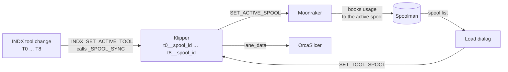

# Spoolman with a Bondtech INDX (T0–T8)

[Deutsche Version → SPOOLMAN.de.md](SPOOLMAN.de.md)

One Spoolman spool per INDX tool. The active spool follows the tool on the head,
so filament usage is booked to the right spool, and OrcaSlicer can pick up the
colour and profile of every tool.

> Written for the machine in this repo (Voron Trident 350, INDX with 9 tools,
> Kalico, Mainsail, OrcaSlicer 2.5.x on Windows). Names such as the Orca
> printer profile "Voron Trident 350 INDX", the user `pi` and the tool count
> are from that machine; adjust them to yours.

**Requirements:** the INDX config from Bondtech, `[save_variables]` with
`indx_vars.cfg` (in this repo in `config/INDX_toolhead.cfg`), this repo's
`klipper/` content in your config folder (see
[INSTALLATION.md](INSTALLATION.md)), Moonraker with network access to Spoolman.

## How it fits together



Simplified: each tool has a spool ID stored in Klipper. When a tool is picked
up, its spool becomes the active spool in Moonraker, and Moonraker books the
extruded filament to it in Spoolman. OrcaSlicer reads the tool → spool mapping
(see [ORCASLICER.md](ORCASLICER.md)).

**Which steps?**
- Spoolman already runs (on the Pi or a NAS) and Moonraker knows it: check
  step 0, then steps 3 and 4.
- Spoolman runs, but `moonraker.conf` has no `[spoolman]` section: steps 0, 2,
  3, 4.
- No Spoolman yet: steps 0–4.

## 0. Check first: is Spoolman already running?

If your `moonraker.conf` already contains a `[spoolman]` section, open the
address from its `server:` line in a browser.

- **The Spoolman UI shows up:** Spoolman already runs (on the Pi or on another
  device such as a NAS). Skip step 1.
- **No page:** install Spoolman, e.g. on the Pi as in step 1. To find out
  whether the address in `server:` is the Pi itself, run `hostname -I` on the
  Pi and compare.

Without a `[spoolman]` section: install Spoolman (step 1) and add the section
in step 2.

## 1. Install on the Pi (via SSH)

**Recommended: standalone.** A CM4 has little RAM, and Docker adds an extra
daemon and memory use. Standalone runs as a systemd service and can be
updated through the Mainsail update manager. Docker is only worth it if Docker
already runs on the Pi.

```bash
cd ~ && sudo apt-get update && sudo apt-get install -y curl jq unzip
```

```bash
mkdir -p ~/Spoolman && cd ~ && source_url=$(curl -s https://api.github.com/repos/Donkie/Spoolman/releases/latest | jq -r '.assets[] | select(.name == "spoolman.zip").browser_download_url') && curl -sSL "$source_url" -o temp.zip && unzip temp.zip -d ./Spoolman && rm temp.zip
```

```bash
cd ~/Spoolman && bash ./scripts/install.sh
```

The script asks for the port (default 7912) and whether to create a systemd
service: **yes**. Then check:

```bash
systemctl status Spoolman
```

Web UI: `http://<PI-IP>:7912`. The database lives in
`~/.local/share/spoolman` and survives updates.

<details><summary>Alternative: Docker</summary>

```yaml
# ~/spoolman/docker-compose.yml
services:
  spoolman:
    image: ghcr.io/donkie/spoolman:latest
    restart: unless-stopped
    volumes:
      - ./data:/home/app/.local/share/spoolman
    ports:
      - "7912:8000"
    environment:
      - TZ=Europe/Berlin
```

```bash
cd ~/spoolman && docker compose up -d
```
</details>

## 2. `moonraker.conf`

```ini
[spoolman]
server: http://localhost:7912
sync_rate: 5
```

`server:` is `http://localhost:7912` if Spoolman runs on the Pi, otherwise
the address of the other device, e.g. `http://<SPOOLMAN-IP>:7912`.

Optional, only for standalone on the Pi, for updates through Mainsail:

```ini
[update_manager spoolman]
type: zip
channel: stable
repo: Donkie/Spoolman
path: ~/Spoolman
virtualenv: .venv
requirements: requirements.txt
persistent_files:
    .venv
    .env
managed_services: Spoolman
```

So that Moonraker may restart the service, `Spoolman` must be on its own line
in `~/printer_data/moonraker.asvc`:

```bash
grep -qx Spoolman ~/printer_data/moonraker.asvc || echo Spoolman >> ~/printer_data/moonraker.asvc
```

```bash
sudo systemctl restart moonraker
```

The Spoolman panel then appears on the Mainsail dashboard.

## 3. Macros

The Spoolman logic is in these files of this repo. If you copied the content
of `klipper/` into your config folder (README, setup), they are already in
place:

| File | Purpose |
|---|---|
| `macros/spoolman.cfg` | Assignment, sync, restore on startup, `spool_id` on T0–T8, OrcaSlicer lanes ([ORCASLICER.md](ORCASLICER.md), section 3) |
| `indx/indx_overrides.cfg` | Overrides Bondtech's `_INDX_SET_ACTIVE_TOOL` with one extra line `_SPOOL_SYNC` at the end |

Check in `printer.cfg`:
- `[include macros/*.cfg]` is present (loads `spoolman.cfg`),
- `[include indx/indx_overrides.cfg]` comes **after** `[include indx/homing.cfg]`,
- `[save_variables]` exists (in this repo in `config/INDX_toolhead.cfg`, file `indx_vars.cfg`).

Then `FIRMWARE_RESTART`.

### How it works

- Each tool's spool ID is stored in `indx_vars.cfg` as `t0__spool_id` …
  `t8__spool_id`. The Mainsail Spoolman dialog saves under the same names as
  long as `[save_variables]` exists, so both use the same values.
- **Pickup T3:** `_INDX_SET_ACTIVE_TOOL TOOL=3` calls `_SPOOL_SYNC`, which runs
  `SET_ACTIVE_SPOOL ID=<spool of T3>`.
- **Park:** `TOOL=-1` leads to `CLEAR_ACTIVE_SPOOL`.
- **Startup:** `INIT_STATE` (Bondtech, `indx-tc-macros.cfg`) reports the tool on the head, its spool
  becomes active again.
- Moonraker books usage continuously to the active spool, including purges
  and `LOAD_FILAMENT`.

### Commands

```
SET_TOOL_SPOOL T=3 ID=12    assign spool 12 to T3
SET_TOOL_SPOOL T=3 ID=0     clear the assignment of T3
                            (UNLOAD_FILAMENT does this automatically)
SHOW_TOOL_SPOOLS            show all assignments
LOAD_FILAMENT               dialog: tool -> material -> spool (assigns it)
```

**Mainsail dialog:** T0–T8 appear in the Spoolman panel under *Change Spool*.
The macro `_SPOOL_WATCH` checks every 3 s whether an assignment changed there
(the "watcher"). If you pick a spool for the tool currently on the head, it
becomes active within 3 s. For a parked tool the spool becomes active on the
next pickup.

If a tool has no spool, a red message appears in the console on pickup. The
print continues, but usage is not tracked.

## 4. Test

1. Create two spools in Spoolman, e.g. ID 1 and 2.
2. `SET_TOOL_SPOOL T=0 ID=1` and `SET_TOOL_SPOOL T=1 ID=2`, then `SHOW_TOOL_SPOOLS`.
3. `T0` → console reports "Spoolman: T0 -> spool 1", the Spoolman panel shows spool 1.
4. With filament loaded in T0, heat to its printing temperature (e.g.
   `M109 S220`), move the head over the purge bucket or raise Z so the
   filament can come out freely, then `G1 E50 F300` → after about 5 s the
   remaining weight of spool 1 drops. Do not extrude with a cold nozzle.
5. `T1` → spool 2 active, extrude again, only spool 2 decreases.
6. `PARK_TOOL` (Bondtech macro) → no active spool.
7. `FIRMWARE_RESTART` with T1 on the head → `SHOW_TOOL_SPOOLS` shows the assignments again, spool 2 is active.

## 5. OrcaSlicer

Colours and filament profiles from Spoolman in OrcaSlicer:
[ORCASLICER.md](ORCASLICER.md).

## Problems

See [TROUBLESHOOTING.md](TROUBLESHOOTING.md#spoolman-and-orcaslicer).
